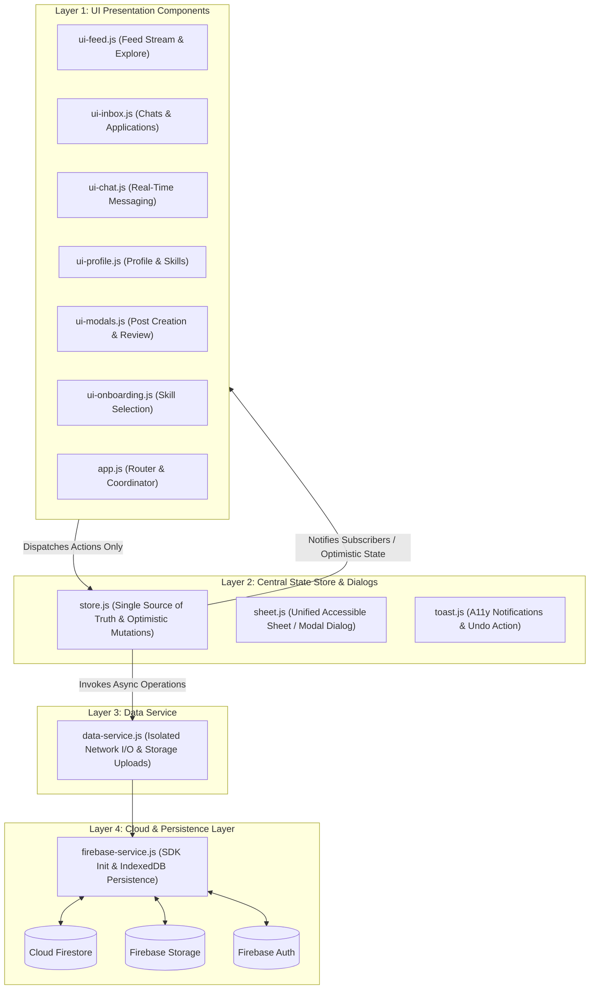

# SyncUp — Peer-to-Peer Project Collaboration & Teammate Discovery Platform

> A modern, production-grade collaboration platform for student developers, hackathon teams, and creator communities.

🌐 **Live Web Application:** [https://shreya132-ai.github.io/SyncUp-web/](https://shreya132-ai.github.io/SyncUp-web/)  
💻 **Repository:** [https://github.com/shreya132-ai/SyncUp-web](https://github.com/shreya132-ai/SyncUp-web)

---

## 🏛️ System Architecture & Four-Layer Data Flow

SyncUp is built with a clean, unidirectional four-layer architecture ensuring high performance, zero-latency optimistic updates, native offline resilience, and strict separation of concerns.



### Architectural Responsibilities:
1. **Layer 1 (UI Components):** Only render state and dispatch store actions (e.g. `store.applyToPost(id)`). UI components never communicate directly with Firestore.
2. **Layer 2 (Central State Store):** The single source of truth for all domain entities (`posts`, `user`, `myUploads`, `chats`, `ui`). Implements optimistic UI updates with automatic rollbacks if remote synchronization fails.
3. **Layer 3 (Data Service):** The ONLY module that talks to Cloud Firestore and Firebase Storage. Encapsulates queries, real-time listeners (`onSnapshot`), mutations, and image uploads.
4. **Layer 4 (Firebase Infrastructure):** Native persistent local cache (`db.enablePersistence`) backed by browser IndexedDB, eliminating manual `localStorage` post/chat mirrors.

---

## 📁 Repository Folder Structure

```
SyncUp-Project/
├── css/                                  # Layered Modular Stylesheets
│   ├── variables.css                     # Design tokens (Colors, 8px grid, typography, WCAG AA)
│   ├── layout.css                        # App shell, responsive 3-column grid & bottom bar
│   ├── components.css                    # Buttons, badges, cards, inputs, tags
│   ├── chat.css                          # Collaborator chat layout, speech bubbles, typing indicators
│   └── modals.css                        # Reusable sheets, bottom sheets, focus outlines
├── js/                                   # Four-Layer JavaScript Modules
│   ├── firebase-service.js               # Layer 4: Firebase SDK init & IndexedDB persistence
│   ├── data-service.js                   # Layer 3: Isolated Firestore & Storage data layer
│   ├── store.js                          # Layer 2: Central state store & optimistic updates
│   ├── sheet.js                          # Reusable <Sheet> dialog controller (mobile/desktop)
│   ├── toast.js                          # Accessible toast notifications with Undo action
│   ├── utils.js                          # XSS escaping, canvas image compression (<70KB)
│   ├── ui-feed.js                        # Layer 1: Feed stream, pagination, filters, explore
│   ├── ui-inbox.js                       # Layer 1: Unified inbox (Chats & Applications)
│   ├── ui-chat.js                        # Layer 1: 1-on-1 direct messages & global room
│   ├── ui-uploads.js                     # Layer 1: "My Uploads" showcase & delete actions
│   ├── ui-profile.js                     # Layer 1: Developer profile & skill badges
│   ├── ui-modals.js                      # Layer 1: Post creation wizard, application review
│   ├── ui-onboarding.js                  # Layer 1: Post sign-up skill selection
│   ├── ui-auth.js                        # Layer 1: Login, registration, Google auth, Demo guest
│   └── app.js                            # App coordinator, routing, debounced search
├── firestore.rules                       # Production Firestore security rules
├── test-e2e-quality-pass.js              # Comprehensive E2E automated test suite (72 tests)
├── index.html                            # Primary web application entry point
├── syncup.html                           # Synchronized secondary web entry point
├── start.bat                             # Windows batch script to launch the app locally
├── CHANGELOG.md                          # Phase-by-phase changelog and migration guide
└── README.md                             # Project overview and architecture guide
```

---

## 🌟 Key Features & Storyboard Architecture

### 1. 🎨 Forest & Emerald Design System
* **WCAG AA Compliant Colors:** Primary button `#087F5B` (white text: 5.05:1), Accent `#10B981` (restricted to fills/icons), Slate 900 text `#0F172A` (16.2:1 AAA), Canvas `#F8FAFC`, Sidebar `#064E3B` (9.5:1 AAA).
* **Strict 8px Grid:** Spacing tokens (`4px`, `8px`, `16px`, `24px`, `32px`).
* **Inter Typography Scale:** Standardized font sizes (`12px`, `14px`, `16px`, `20px`, `28px`).
* **Touch Targets:** Minimum `≥ 44×44px` across interactive controls.
* **Responsive 3-Column Desktop:** Fixed dark-green sidebar (`#064E3B`, 240px), centered feed column (max-width 720px), and right rail (300px) displaying Suggested Teams, Your Applications, and Trending Skills.
* **Mobile Navigation:** 5-destination bottom navigation bar with raised center `+` FAB.

### 2. 🤝 Team Application & Review Workflow
* **"Apply to Join Team":** Developers specify role and a custom pitch.
* **One-Click Apply:** CTA transitions to a disabled `Applied ✓` state to prevent duplicate submissions.
* **Lead Application Review:** Post owners can review candidates with **Accept** and **Decline** actions.
* **Seamless Chat Handoff:** Accepting a candidate automatically launches a direct 1-on-1 chat and delivers a personalized welcome greeting.
* **Interactive Undo:** Declining an application presents an instant toast notification with an **Undo** button.

### 3. 💬 Real-Time Collaborator Chat
* **Private 1-on-1 DMs:** Direct conversations between collaborators.
* **Global Community Room:** Public broadcast channel for hackathon rallying.
* **Typing & Read Indicators:** Visual feedback (`... is typing`) and read receipts (`✓✓ Read`).

### 4. 📝 Two-Step Post Creation Wizard
* **Two Steps:** Step 1: Write Details → Step 2: Live Preview.
* **Dynamic Word Limit:** Real-time counter (`42 / 100 words`), turns amber at 90 words, red at 100 words, announced via `aria-live`.
* **Client-Side Image Compression:** HTML5 Canvas resizes and compresses screenshots under 70 KB before uploading to Firebase Storage.

### 5. 🔒 Security & Privacy Protection
* **Zero Email Leakage:** Emails are never exposed in public feeds or headers; users interact via display names and handles.
* **XSS Sanitization:** All user-generated text is sanitized before rendering.
* **Firestore Security Rules:** Users can only modify their own profile and posts. Non-owners cannot accept or decline applications.

---

## 🛠️ Tech Stack

* **Frontend:** Vanilla modern ES6+ JavaScript, HTML5, CSS3, Google Fonts (Inter).
* **Backend & Real-Time Database:** Cloud Firestore (v9 compat mode), Firebase Authentication, Firebase Storage.
* **Offline Storage:** IndexedDB via Firestore's built-in `enablePersistence`.
* **Testing:** Node.js automated DOM assertion test suite (`test-e2e-quality-pass.js`).
* **Deployment:** GitHub Pages / Any static hosting.

---

## 🚀 How to Run Locally

### Option 1: Direct File Open
Double-click `index.html` or `syncup.html` in any modern web browser (Edge, Chrome, Firefox, Safari).

### Option 2: Windows Batch Script
Double-click `start.bat` in the project root directory.

### Option 3: Local Development Server
Serve using any static web server:
```bash
# Using Python
python -m http.server 8080

# Using Node.js npx
npx serve .
```

### Instant Preview (No Sign-Up Needed)
Click **"🚀 Preview Demo"** on the landing screen to test all features instantly as an authorized developer (`Shreya Sinha`, Amity University Patna).

---

## 🧪 Running Automated Tests

Run the comprehensive 72-assertion test suite locally:
```bash
node test-e2e-quality-pass.js
```
Expected result: **72 / 72 assertions passed (100%)**.
