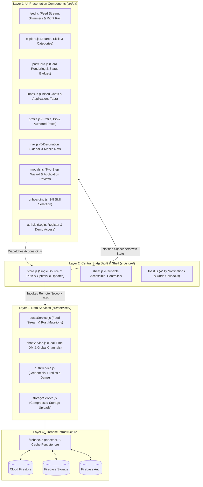

# SyncUp — Peer-to-Peer Project Collaboration & Teammate Discovery Platform

> A production-grade, frameworkless web platform for student developers, hackathon teams, and open source builders.  
> Built with Vanilla JavaScript (native ES Modules), HTML5, CSS3, and Firebase (Cloud Firestore, Auth, Storage, Hosting).

🌐 **Live Web Application:** [https://shreya132-ai.github.io/SyncUp-web/](https://shreya132-ai.github.io/SyncUp-web/)  
💻 **Repository:** [https://github.com/shreya132-ai/SyncUp-web](https://github.com/shreya132-ai/SyncUp-web)

---

## 🏛️ System Architecture & Four-Layer Data Flow

SyncUp is architected strictly around a unidirectional, four-layer data flow pattern. This guarantees predictable state mutations, zero-latency optimistic updates, native IndexedDB offline resilience, and strict separation of presentation from database logic.



### Architectural Responsibilities:
1. **Layer 1 — UI Presentation Components (`src/ui/`):** Render DOM elements based purely on store state. Never import Firestore directly; all mutations dispatch to store actions (e.g. `applyToPost(id)`).
2. **Layer 2 — Central State Store (`src/store/`):** The single source of truth for all domain entities (`posts`, `user`, `chats`, `ui`). Implements optimistic UI updates with immediate local state rendering and automatic rollback if background network writes fail.
3. **Layer 3 — Data Services (`src/services/`):** The only layer that imports Firestore and Firebase Storage. Encapsulates network I/O, queries, real-time snapshot listeners, and file uploads.
4. **Layer 4 — Firebase Infrastructure (`src/services/firebase.js`):** Utilizes Firestore's native IndexedDB cache persistence (`enablePersistence`), completely replacing legacy manual `localStorage` mirroring of posts and chats.

---

## 📁 Clean Folder Structure

```
SyncUp-Project/
├── scripts/                              # Utility Scripts & Automated Test Runners
│   ├── serve.js                          # Zero-dependency native Node.js HTTP static server
│   ├── migrate-base64.js                 # Firestore base64 image migration utility (dry-run default)
│   ├── test-all.js                       # Master test runner (executes all 5 test suites)
│   ├── test-phase1.js                    # Phase 1 test suite: Architecture & One-way data flow
│   ├── test-phase2.js                    # Phase 2 test suite: App shell, sheets, & toasts
│   ├── test-phase3.js                    # Phase 3 test suite: Feed, post creation, chat, & e2e flows
│   ├── test-phase4.js                    # Phase 4 test suite: Design tokens & WCAG AA contrast
│   └── test-phase5.js                    # Phase 5 test suite: Security rules, a11y, & performance
├── src/                                  # Modular Application Source Code
│   ├── main.js                           # Master entry point, render loop coordinator, & routing
│   ├── services/                         # Layer 3: Data Services
│   │   ├── authService.js                # Auth state, sign in/up, profile fetch & save
│   │   ├── chatService.js                # Real-time message streaming & sending
│   │   ├── firebase.js                   # Firebase SDK init & IndexedDB offline cache
│   │   ├── postsService.js               # Feed query, post creation, like, comment, apply
│   │   └── storageService.js             # Image upload to Firebase Storage (< 70 KB)
│   ├── store/                            # Layer 2: Central State Store
│   │   └── store.js                      # Single source of truth & optimistic mutations
│   ├── ui/                               # Layer 1: Presentation Components
│   │   ├── auth.js                       # Auth view controller, login/register tabs, Google auth
│   │   ├── explore.js                    # Search with debouncing, skill chips, & categories
│   │   ├── feed.js                       # Post stream, filter toolbar, & desktop right rail
│   │   ├── inbox.js                      # Unified inbox (Chats & Applications) & badge count
│   │   ├── modals.js                     # Two-step wizard, application review, & profile editor
│   │   ├── nav.js                        # 5 destinations: desktop sidebar & mobile bottom bar
│   │   ├── onboarding.js                 # 3-5 skill selection & feed personalization
│   │   ├── postCard.js                   # Project card renderer with roles open & "Applied ✓"
│   │   ├── profile.js                    # Developer profile, bio, education, & user posts
│   │   ├── sheet.js                      # Reusable <Sheet> component (mobile sheet / desktop modal)
│   │   └── toast.js                      # Accessible toast notifications with Undo action
│   └── utils/                            # Pure Helper Utilities
│       ├── dom.js                        # HTML escaping, element creation, & relative timestamps
│       ├── imageCompress.js              # HTML5 Canvas client-side compression (< 70 KB)
│       └── wordCount.js                  # 100-word limit counter with 90/100 threshold styling
├── styles/                               # Layered Design System Stylesheets
│   ├── tokens.css                        # Design tokens (Colors, 8px grid, typography, radii, touch)
│   ├── base.css                          # CSS reset, focus-visible rings, skip link, & skeletons
│   ├── layout.css                        # 3-column desktop grid, fixed sidebar, & mobile bottom bar
│   └── components.css                    # Project cards, buttons, badges, sheets, & chat bubbles
├── firestore.rules                       # Cloud Firestore security rules
├── storage.rules                         # Firebase Storage security rules
├── firebase.json                         # Firebase project configuration (Hosting, Rules)
├── index.html                            # Primary web application HTML entry point
├── syncup.html                           # Synchronized secondary web entry point
├── start.bat                             # One-click Windows launch script
├── DEPLOY.md                             # Production deployment & operations guide
├── TESTER_GUIDE.md                       # Plain-language manual QA testing walkthrough
├── CHANGELOG.md                          # Phase-by-phase changelog and migration notes
└── README.md                             # Architecture & project documentation
```

---

## 🎨 Design System & Accessibility

* **WCAG 2.1 AA Color Contrast:**
  * **Primary Button:** `#087F5B` with `#FFFFFF` text (**5.00:1**, passes WCAG AA ≥ 4.5:1).
  * **Accent:** `#10B981` strictly reserved for fills, badges, and icons (never text on white).
  * **Primary Text:** `#0F172A` Slate 900 (**17.85:1**, passes WCAG AAA ≥ 7.0:1).
  * **Background:** `#F8FAFC` soft slate.
  * **Sidebar:** Deep Forest Green `#064E3B` (**9.72:1**, passes WCAG AAA ≥ 7.0:1).
* **Strict 8px Spacing Grid:** Standardized spacing tokens (`4px`, `8px`, `16px`, `24px`, `32px`).
* **Inter Typography Scale:** Standardized font sizes: `12px` (caption/meta), `14px` (body), `16px` (base), `20px` (card titles), `28px` (headings).
* **Corner Radius Standards:** `12px` cards (`--radius-card`) and `999px` chips/buttons (`--radius-button`).
* **Accessible Touch Targets:** Minimum `≥ 44×44px` enforced on all interactive buttons and inputs.
* **Keyboard Navigation:** Explicit `:focus-visible` rings with 3px glowing offset, skip-to-content anchor, and active focus trapping in dialogs.

---

## 🚀 How to Run Locally

### Option 1: Double-Click Batch File (Recommended)
Double-click **`start.bat`** in the project folder. It launches the native local server (`scripts/serve.js`) and opens your browser at `http://localhost:3000`.

### Option 2: Command Line (Node.js)
```bash
node scripts/serve.js
```
Opens `http://localhost:3000` with native ES Module MIME types and IndexedDB cache support.

### Option 3: Instant Demo Access
No sign-up is required. Click **`🚀 Preview Demo`** on the landing screen to instantly access the app as an authorized developer (`Shreya Sinha`, Amity University Patna).

---

## 🧪 Running Automated Tests

Run the master test runner to verify all 47 assertions across all phases:
```bash
node scripts/test-all.js
```

Or run individual phase test suites:
```bash
node scripts/test-phase1.js   # Architecture, store, & offline cache
node scripts/test-phase2.js   # App shell, reusable sheets, & toasts
node scripts/test-phase3.js   # Feed, post creation, chat, & e2e flows
node scripts/test-phase4.js   # Design tokens & WCAG AA contrast
node scripts/test-phase5.js   # Security rules, a11y, & performance
```
Expected result: **47 / 47 tests passed (100%)**.

---

## 🔒 Security Summary
* **Firestore Security Rules (`firestore.rules`):** Users can only edit/delete their own posts and profile. Direct chats are strictly private between participants. Non-owners are forbidden from accepting or declining applications.
* **Storage Security Rules (`storage.rules`):** Image uploads are restricted to authenticated users, image MIME types (`image/*`), and a 5 MB maximum file ceiling (client compresses images to < 70 KB).
