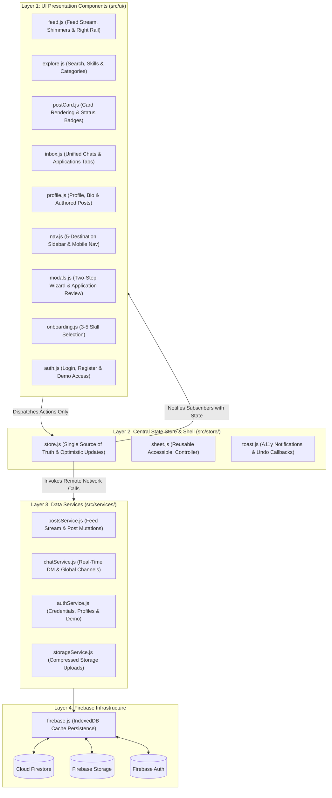

# SyncUp — Peer-to-Peer Project Collaboration & Teammate Discovery Platform

> A production-grade, frameworkless web platform for student developers, hackathon teams, and open source builders.  
> Built with Vanilla JavaScript (native ES Modules), HTML5, CSS3, and Firebase (Cloud Firestore, Auth, Storage, Hosting).

🌐 **Live Web Application:** [https://shreya132-ai.github.io/SyncUp-web/](https://shreya132-ai.github.io/SyncUp-web/)  
💻 **Repository:** [https://github.com/shreya132-ai/SyncUp-web](https://github.com/shreya132-ai/SyncUp-web)

---

## 🏛️ System Architecture & Four-Layer Data Flow

SyncUp is architected strictly around a unidirectional, four-layer data flow pattern. This guarantees predictable state mutations, zero-latency optimistic updates, native IndexedDB offline resilience, and strict separation of presentation from database logic.



### Architectural Responsibilities:
1. **Layer 1 — UI Presentation Components (`src/ui/`):** Render DOM elements based purely on store state. Never import Firestore directly; all mutations dispatch to store actions (e.g. `applyToPost(id)`).
2. **Layer 2 — Central State Store (`src/store/`):** The single source of truth for all domain entities (`posts`, `user`, `chats`, `ui`). Implements optimistic UI updates with immediate local state rendering and automatic rollback if background network writes fail.
3. **Layer 3 — Data Services (`src/services/`):** The only layer that imports Firestore and Firebase Storage. Encapsulates network I/O, queries, real-time snapshot listeners, and file uploads.
4. **Layer 4 — Firebase Infrastructure (`src/services/firebase.js`):** Utilizes Firestore's native IndexedDB cache persistence (`enablePersistence`), completely replacing legacy manual `localStorage` mirroring of posts and chats.

---

## 📁 Clean Folder Structure

```
SyncUp-Project/
├── scripts/                              # Utility Scripts & Automated Test Runners
│   ├── serve.js                          # Zero-dependency native Node.js HTTP static server
│   ├── migrate-base64.js                 # Firestore base64 image migration utility (dry-run default)
│   ├── test-all.js                       # Master test runner (executes all 5 test suites)
│   ├── test-phase1.js                    # Phase 1 test suite: Architecture & One-way data flow
│   ├── test-phase2.js                    # Phase 2 test suite: App shell, sheets, & toasts
│   ├── test-phase3.js                    # Phase 3 test suite: Feed, post creation, chat, & e2e flows
│   ├── test-phase4.js                    # Phase 4 test suite: Design tokens & WCAG AA contrast
│   └── test-phase5.js                    # Phase 5 test suite: Security rules, a11y, & performance
├── src/                                  # Modular Application Source Code
│   ├── main.js                           # Master entry point, render loop coordinator, & routing
│   ├── services/                         # Layer 3: Data Services
│   │   ├── authService.js                # Auth state, sign in/up, profile fetch & save
│   │   ├── chatService.js                # Real-time message streaming & sending
│   │   ├── firebase.js                   # Firebase SDK init & IndexedDB offline cache
│   │   ├── postsService.js               # Feed query, post creation, like, comment, apply
│   │   └── storageService.js             # Compressed Storage uploads (avatars < 70 KB, posts < 150 KB)
│   ├── store/                            # Layer 2: Central State Store
│   │   └── store.js                      # Single source of truth & optimistic mutations
│   ├── ui/                               # Layer 1: Presentation Components
│   │   ├── auth.js                       # Auth view controller, login/register tabs, Google auth
│   │   ├── explore.js                    # Search with debouncing, skill chips, & categories
│   │   ├── feed.js                       # Post stream, filter toolbar, & desktop right rail
│   │   ├── inbox.js                      # Unified inbox (Chats & Applications) & badge count
│   │   ├── modals.js                     # Two-step wizard, application review, & profile editor
│   │   ├── nav.js                        # 5 destinations: desktop sidebar & mobile bottom bar
│   │   ├── onboarding.js                 # 3-5 skill selection & feed personalization
│   │   ├── postCard.js                   # Project card renderer with roles open & "Applied ✓"
│   │   ├── profile.js                    # Developer profile, bio, education, & user posts
│   │   ├── sheet.js                      # Reusable <Sheet> component (mobile sheet / desktop modal)
│   │   └── toast.js                      # Accessible toast notifications with Undo action
│   └── utils/                            # Pure Helper Utilities
│       ├── dom.js                        # HTML escaping, element creation, safeUrl, & relative timestamps
│       ├── imageCompress.js              # HTML5 Canvas iterative compression (avatars < 70KB, posts < 150KB)
│       └── wordCount.js                  # 100-word limit counter with 90/100 threshold styling
├── styles/                               # Layered Design System Stylesheets
│   ├── tokens.css                        # Design tokens (Colors, 8px grid, typography, radii, touch)
│   ├── base.css                          # CSS reset, focus-visible rings, skip link, & skeletons
│   ├── layout.css                        # 3-column desktop grid, fixed sidebar, & mobile bottom bar
│   └── components.css                    # Project cards, buttons, badges, sheets, & chat bubbles
├── firestore.rules                       # Cloud Firestore security rules
├── storage.rules                         # Firebase Storage security rules
├── firebase.json                         # Firebase project configuration (Hosting, Rules)
├── index.html                            # Primary web application HTML entry point (single entry point)
├── start.bat                             # One-click Windows launch script
├── DEPLOY.md                             # Production deployment & operations guide
├── TESTER_GUIDE.md                       # Plain-language manual QA testing walkthrough
├── CHANGELOG.md                          # Phase-by-phase changelog and migration notes
└── README.md                             # Architecture & project documentation
```

---

## 🎨 Design System & Accessibility

* **WCAG 2.1 AA Color Contrast:**
  * **Primary Button:** `#087F5B` with `#FFFFFF` text (**5.00:1**, passes WCAG AA ≥ 4.5:1).
  * **Accent:** `#10B981` strictly reserved for fills, badges, and icons (never text on white).
  * **Primary Text:** `#0F172A` Slate 900 (**17.85:1**, passes WCAG AAA ≥ 7.0:1).
  * **Background:** `#F8FAFC` soft slate.
  * **Sidebar:** Deep Forest Green `#064E3B` (**9.72:1**, passes WCAG AAA ≥ 7.0:1).
* **Strict 8px Spacing Grid:** Standardized spacing tokens (`4px`, `8px`, `16px`, `24px`, `32px`).
* **Inter Typography Scale:** Standardized font sizes: `12px` (caption/meta), `14px` (body), `16px` (base), `20px` (card titles), `28px` (headings).
* **Corner Radius Standards:** `12px` cards (`--radius-card`) and `999px` chips/buttons (`--radius-button`).
* **Accessible Touch Targets:** Minimum `≥ 44×44px` enforced on all interactive buttons and inputs.
* **Keyboard Navigation:** Explicit `:focus-visible` rings with 3px glowing offset, skip-to-content anchor, and active focus trapping in dialogs.

---

## 🚀 How to Run Locally

### Option 1: Double-Click Batch File (Recommended)
Double-click **`start.bat`** in the project folder. It launches the native local server (`scripts/serve.js`) and opens your browser at `http://localhost:3000`.

### Option 2: Command Line (Node.js)
```bash
node scripts/serve.js
```
Opens `http://localhost:3000` with native ES Module MIME types and IndexedDB cache support.

### Option 3: Instant Demo Access
No sign-up is required. Click **`🚀 Preview Demo`** on the landing screen to instantly access the app as an authorized developer (`Shreya Sinha`, Amity University Patna).

---

## 🧪 Running Automated Tests

Run the master test runner to verify all 47 assertions across all phases:
```bash
node scripts/test-all.js
```

Or run individual phase test suites:
```bash
node scripts/test-phase1.js   # Architecture, store, & offline cache
node scripts/test-phase2.js   # App shell, reusable sheets, & toasts
node scripts/test-phase3.js   # Feed, post creation, chat, & e2e flows
node scripts/test-phase4.js   # Design tokens & WCAG AA contrast
node scripts/test-phase5.js   # Security rules, a11y, & performance
```
Expected result: **47 / 47 tests passed (100%)**.

---

## 🔒 Security Architecture & Hardening Guide

SyncUp employs a multi-tiered, defense-in-depth security model spanning DOM sanitization, client-side event delegation, strict Firebase Security Rules, and cloud infrastructure safeguards:

### 1. XSS Prevention & Event Delegation
* **Elimination of Inline JavaScript Handlers:** All dynamic elements across the Feed, Inbox, Modals, Profile, and Explore views are refactored from inline `onclick` string handlers to declarative `data-action` and `data-*` attributes.
* **Single Centralized Event Delegator:** A single master click listener attached to `document` intercepts actions (such as `like-post`, `apply-team`, `chat-cta`, `update-app-status`), completely preventing attribute-decoding XSS execution.
* **Context-Aware Escaping:** `escapeHtml` is strictly preserved for raw text rendering and attribute values, preventing tag injection while avoiding JavaScript evaluation of unescaped HTML entities.

### 2. URL Safety Sanitization (`safeUrl`)
* **Strict Protocol Enforcement:** The `safeUrl(u)` helper verifies all candidate URLs using the standard `new URL()` parser, strictly permitting only `http:` and `https:` schemes.
* **Dangerous Schemes Blocked:** Protocol vectors such as `javascript:`, `data:text/html`, and `vbscript:` are immediately rejected and return an empty string.
* **Write & Render Validation:** Applied across all GitHub repository links (`githubUrl`), live project demo links (`demoUrl`), author avatar photos, and project screenshots before being written to Firestore or rendered into `href` or `src` attributes. External links always include `rel="noopener noreferrer" target="_blank"`.

### 3. Hardened Cloud Firestore Security Rules (`firestore.rules`)
Each rule enforces strict boundary checks and least-privilege access:
* **Likes Subcollection (`posts/{id}/likes/{uid}`):**
  * *Doc ID == auth.uid:* Guarantees exactly one like per user without distributed race conditions.
  * *Owner-Only Mutations:* Users can only `create` or `delete` their own like document (`request.auth.uid == uid`). Updates are denied.
* **Comments Subcollection (`posts/{id}/comments/{commentId}`):**
  * *Author Identity:* Authenticated creation requires `request.resource.data.authorUid == request.auth.uid`.
  * *Size Limits:* Comment text is limited to 1–500 characters.
  * *Author-Only Delete:* Only the comment author can delete their comment. Updates are denied.
* **Applications Subcollection (`posts/{id}/applications/{appId}`):**
  * *Privacy Isolation:* Fixes the privacy leak where pitches sat in public post documents. Third parties cannot read another candidate's application.
  * *Applicant Read:* Applicants can read only their own application (`resource.data.applicantUid == request.auth.uid`).
  * *Owner Read & Triage:* The project lead can read all applications for their post and has exclusive authorization to update application status to `'accepted'` or `'declined'`.
  * *Pending on Create:* New applications must be created with `status == 'pending'` and pitch `<= 1000` characters.
* **Project Posts (`posts/{postId}`):**
  * *Field Validation:* Validates post title (`<= 120` chars), description (`<= 800` chars), skills array (`<= 10` tags), and status (`Recruiting`, `In Progress`, `Completed`).
  * *Immutable Author:* Post owners cannot alter the `userUid` field during updates.
* **User Profiles (`users/{userId}`):**
  * *Private Field Protection:* The public user profile document excludes email addresses to prevent data harvesting. Private account information resides in `/users/{userId}/private/account`, readable and writable exclusively by the account owner.
  * *Username Uniqueness (`usernames/{handle}`):* Manages claim mappings to guarantee unique user handles across the platform.
* **Default Deny:** All unmapped documents and collections default to `allow read, write: if false;`.

### 4. Firebase Storage Rules (`storage.rules`)
* **Authenticated Access Only:** All uploads require an active Firebase Auth session (`request.auth != null`).
* **Content-Type & Size Ceilings:** Strict MIME checking (`image/*`) and a 500 KB maximum file limit (`< 500 * 1024`).
* **Path-Based Ownership:** Users can write only to their own designated storage locations:
  * Avatars: `avatars/{uid}.jpg` (strictly `request.auth.uid == userId`)
  * Post images: `posts/{uid}/...` (strictly `request.auth.uid == userId`)
* **Default Deny:** All other bucket paths are denied.

### 5. Client-Side Image Compression with Enforced Targets
* **Iterative Compression Loop:** HTML5 Canvas compressor (`src/utils/imageCompress.js`) loops reducing JPEG quality (from 0.85 down to 0.4) and dimensions iteratively until the target byte size is met:
  * **Avatar Images:** Compressed to strictly `< 70 KB` (max 400×400px).
  * **Post Screenshots:** Compressed to strictly `< 150 KB` (max 1200×1200px).
* **Graceful Failure:** If an oversized or corrupted image cannot be compressed under the threshold, it rejects with a user-friendly error toast instead of crashing or exceeding storage rules.

### 6. Content Security Policy (CSP) & External Link Hardening
* **CSP `<meta>` Tag:** Enforces least-privilege origins tailored to Firebase SDKs and Google Fonts:
  * `default-src 'self'`
  * `script-src 'self' 'unsafe-inline' https://www.gstatic.com`
  * `style-src 'self' 'unsafe-inline' https://fonts.googleapis.com`
  * `font-src 'self' https://fonts.gstatic.com`
  * `img-src 'self' data: blob: https://www.gstatic.com https://firebasestorage.googleapis.com https://*.googleusercontent.com`
  * `connect-src 'self' https://*.googleapis.com https://*.firebaseio.com wss://*.firebaseio.com https://identitytoolkit.googleapis.com https://securetoken.googleapis.com`
  * `object-src 'none'; base-uri 'self'`
* **External Link Hardening:** All outbound links (GitHub, LinkedIn, live demos) enforce `rel="noopener noreferrer" target="_blank"` to eliminate tab-napping and reverse tab exploitation.

### 7. Firebase Web API Keys & Production Console Hardening
> [!IMPORTANT]
> **Firebase Web API Keys are Public by Design:**
> In the Firebase Web Client architecture, the `apiKey` specified in `firebase.js` is merely a project identifier passed to Google backend APIs to route requests to your Firebase project. It is **not** a secret administrative key and cannot be used by itself to bypass security rules or download private data. Security in Firebase is enforced strictly through **Firestore Security Rules**, **Storage Security Rules**, and **Firebase Authentication JWT tokens**.

#### Recommended Production Console Checklist:
1. **Restrict Authorized Domains:**
   * Go to **Firebase Console > Authentication > Settings > Authorized Domains**.
   * In production, remove `localhost` and authorize only your verified domain (e.g. `shreya132-ai.github.io`).
   * In **Google Cloud Console > APIs & Services > Credentials**, locate your Browser API Key and add an **HTTP Referrer restriction** (e.g. `https://shreya132-ai.github.io/*`).
2. **Enable Firebase App Check (Recommended):**
   * Navigate to **Firebase Console > App Check**.
   * Register your web app with **reCAPTCHA Enterprise** or **reCAPTCHA v3**.
   * Enforce App Check for Cloud Firestore and Firebase Storage to protect backend endpoints against abusive bots and automated scraping.
3. **Configure Google Cloud Budget Alerts & Quota Caps:**
   * In **Google Cloud Console > Billing > Budgets & Alerts**, set a monthly spending limit (e.g. $10 or $25) with alerts at 50%, 90%, and 100%.
   * In Cloud Firestore Quotas, configure daily read/write rate limit alerts to protect against unexpected traffic surges.

### 8. Client-Side Rate Limiting & Debouncing
* **Button Locks While Pending:** Project post publishing (`#btn-submit-post`), team applications (`#btn-submit-application`), profile saves (`#btn-save-profile`), and reports disable submit buttons immediately upon click, preventing duplicate network requests and double-submits.
* **Debounced Search:** Global search and explore filters use a 250ms debounce timer to prevent firing redundant filter recalculations on every keystroke.
* **In-Flight Action Guards:** Like actions and comment submissions maintain in-flight tracking sets and minimum cooldowns (1000ms for comments, 350ms for likes) to prevent button spamming.
